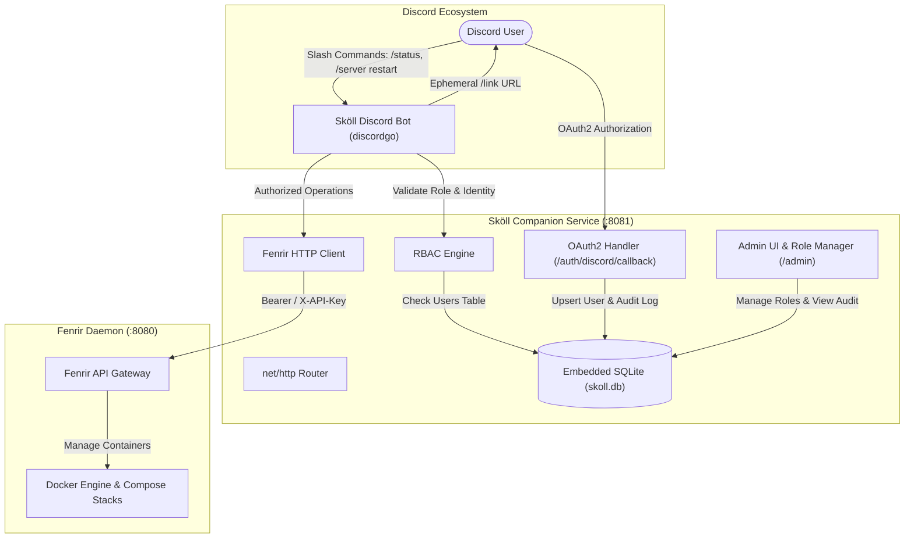

# 🐺 Sköll — Fenrir Daemon Companion Service & Discord Bot

**Sköll** is the secure companion service, OAuth2 identity bridge, and Discord interface for the [Fenrir Daemon](https://github.com/Harkole/fenrir-daemon) Docker container orchestrator. Built in Go, Sköll enables remote monitoring and lifecycle management of container stacks directly from Discord with role-based access control (RBAC), SQLite audit logging, and a web fallback administration dashboard.

---

## 🌟 Key Features

- **Embedded Pure-Go Database (`modernc.org/sqlite`)**:
  - Zero-CGO SQLite engine running in WAL mode with connection pooling.
  - Automatic schema migrations for user identities and detailed audit logging.
  - Secure state token persistence with atomic consumption to eliminate replay attacks.

- **Discord OAuth2 Account Linking**:
  - Ephemeral `/link` slash command generates unique state tokens.
  - Web callback (`/auth/discord/callback`) exchanges OAuth2 codes with Discord, verifies identity, and links users to the database.
  - First registered user is automatically promoted to `Admin`.

- **Granular RBAC Enforcement**:
  - **Admin**: Full stack orchestration (`/stack deploy`, `/stack delete`), user role elevation.
  - **Operator**: Server lifecycle controls (`/server restart`, `/server start`, `/server stop`).
  - **Viewer**: Health and telemetry visibility (`/status`, `/stack list`).
  - **Unlinked**: Blocked with ephemeral instructions to run `/link`.

- **Fenrir Client Bridge**:
  - Secure HTTP client communicating with Fenrir Daemon via `Bearer` and `X-API-Key` headers.
  - Support for health checks, host telemetry (CPU, RAM, Disk), and stack lifecycle execution.

- **Fallback Admin Control Panel (`/admin`)**:
  - Responsive web dashboard for managing linked Discord user roles.
  - Real-time audit activity feed displaying execution logs, user IDs, target stacks, and status.
  - Protected via `SKOLL_ADMIN_KEY` (supports cookie, header, basic auth, or query parameter).

---

## 📐 Architecture Overview



---

## ⚙️ Configuration & Environment Variables

| Variable | Default | Description |
| :--- | :--- | :--- |
| `SKOLL_PORT` | `8081` | Port or address for the HTTP server (e.g. `:8081` or `8081`). |
| `SKOLL_PUBLIC_URL` | `http://localhost:8081` | Public base URL used for OAuth2 callback redirects. |
| `SKOLL_DB_PATH` | `skoll.db` | Filesystem path to the embedded SQLite database. |
| `SKOLL_ADMIN_KEY` | `skoll-admin-secret` | Pre-shared secret required to access the `/admin` UI. |
| `DISCORD_BOT_TOKEN` | *(required for bot)* | Discord Bot Token from the Discord Developer Portal. |
| `DISCORD_CLIENT_ID` | *(required for bot)* | Discord Application Client ID. |
| `DISCORD_CLIENT_SECRET` | *(required for oauth)*| Discord Application Client Secret. |
| `DISCORD_REDIRECT_URI`| `${SKOLL_PUBLIC_URL}/auth/discord/callback` | OAuth2 redirect URL registered in Discord Portal. |
| `FENRIR_API_URL` | `http://localhost:8080` | Base URL of the target Fenrir Daemon instance. |
| `FENRIR_API_KEY` | *(optional)* | Pre-shared API key matching Fenrir's `FENRIR_API_KEY`. |
| `SKOLL_HTTP_TIMEOUT_SECONDS` | `15` | Default timeout for HTTP operations in seconds. |

---

## 🛠️ Discord Application Setup

1. Go to the [Discord Developer Portal](https://discord.com/developers/applications) and create a new application.
2. In the **OAuth2** tab:
   - Add your redirect URI: `http://localhost:8081/auth/discord/callback` (or your domain equivalent).
   - Copy the **Client ID** and **Client Secret**.
3. In the **Bot** tab:
   - Reset and copy the **Bot Token**.
   - Enable **Server Members Intent** and **Message Content Intent** (if needed).
4. Invite the bot to your server using the URL Generator with the `bot` and `applications.commands` scopes, and permissions to Send Messages / Use Slash Commands.

---

## 🛡️ Role-Based Access Control (RBAC)

| Role | Hierarchy Level | Allowed Commands | Description |
| :--- | :---: | :--- | :--- |
| **Admin** | 3 | `/stack deploy`, `/stack list`, `/server restart`, `/server start`, `/server stop`, `/status`, Admin UI role updates | Full infrastructure control and role management. |
| **Operator** | 2 | `/server restart`, `/server start`, `/server stop`, `/status`, `/stack list` | Can restart and manage running server stacks. |
| **Viewer** | 1 | `/status`, `/stack list` | Read-only access to container health and metrics. |
| **Unlinked** | 0 | `/link` | Must authenticate before running any privileged commands. |

> **Note**: The first user to complete the OAuth2 linking flow is automatically granted the **Admin** role. Subsequent users receive **Viewer** by default and can be promoted via the `/admin` web interface.

---

## 💻 Discord Slash Commands

### `/link`
Generates an ephemeral, single-use linking link with a 15-minute expiration time. Clicking the link authenticates the user's Discord ID via Discord OAuth2 and records the user in the database.

### `/status` *(Viewer+)*
Queries Fenrir Daemon for real-time status and returns a formatted embed with:
- Fenrir health and daemon version.
- Host CPU and Memory utilization percentages.
- Registered Docker Compose stacks and their active status (`🟢 running`, `🔴 stopped`).

### `/server restart <name>` *(Operator+)*
Instructs Fenrir Daemon to restart all containers in the specified Docker Compose stack. Records an entry in `audit_logs` detailing the actor, target stack, and result.

### `/server start <name>` / `/server stop <name>` *(Operator+)*
Starts or stops a specific container stack.

### `/stack deploy <name> <compose>` *(Admin)*
Deploys a new Docker Compose stack or updates an existing stack using the provided Compose YAML definition.

---

## 🖥️ Fallback Admin Control Panel (`/admin`)

Sköll includes a built-in web dashboard accessible at:
```
http://localhost:8081/admin?key=skoll-admin-secret
```

### Features:
- **User Role Management**: View all linked users and modify their roles (Admin, Operator, Viewer, Unlinked) via an instant form update.
- **Audit Feed**: Complete activity trail showing timestamps, Discord usernames, Discord user IDs, actions (e.g. `server_restart`, `stack_deploy`), target stacks, and execution statuses (`SUCCESS`, `FAILED`, `UNAUTHORIZED`).
- **Daemon Telemetry**: Real-time connectivity indicator with Fenrir Daemon.

### REST API Endpoints:
- `GET /health` — Service health probe.
- `GET /api/v1/users` — List linked users (Header: `X-Admin-Key: <key>`).
- `POST /api/v1/users/{id}/role` — Update user role (JSON: `{"role": "Operator"}`).
- `GET /api/v1/audit-logs` — Fetch audit logs (Query: `?limit=50`).

---

## 🚀 Building & Running

### Requirements
- Go 1.22+ (Go 1.27+ supported)
- No C compiler or CGO required!

### Run Directly
```bash
# Run with defaults
go run ./cmd/skoll

# Run with environment variables
export DISCORD_BOT_TOKEN="your-bot-token"
export DISCORD_CLIENT_ID="your-client-id"
export DISCORD_CLIENT_SECRET="your-client-secret"
export FENRIR_API_KEY="your-fenrir-key"
go run ./cmd/skoll
```

### Build Executable
```bash
# Windows
go build -o bin/skoll.exe ./cmd/skoll

# Linux / macOS
go build -o bin/skoll ./cmd/skoll
```

### Run All Tests
```bash
go test -v ./...
```

---

## 📄 License
MIT License. Created for the Fenrir & Sköll container orchestration ecosystem.
